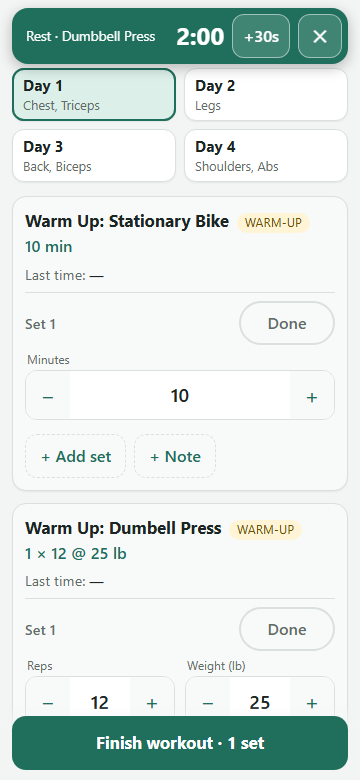
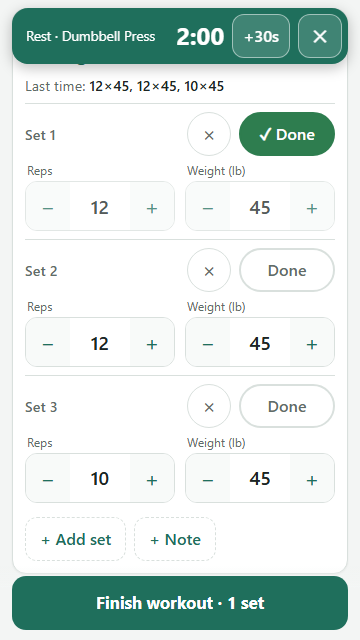

# Father Workout

A simple, phone-friendly workout tracker. Open it between sets, tap **Done**, and it
remembers what you lifted last time. Your history is saved in **your own Google Drive**.

**Use it:** https://fatherworkout.petrellafamily.com

<p>
  
  &nbsp;
  
</p>

## What it does

- **A 4-day dumbbell routine:** chest and triceps, legs, back and biceps, then shoulders and abs.
  It suggests the next day automatically.
- **Last time, at a glance:** each exercise shows what you did last time (e.g. `12×45, 12×45, 10×45`)
  and prefills those numbers, so logging is mostly tapping **Done**.
- **Big buttons, little typing:** +/− steppers for reps and weight, add or remove sets, and an
  optional note per exercise.
- **Rest timer:** marking a set done starts a countdown sized to that exercise's rest time.
- **History:** every finished workout, set by set.
- **Picks up where you left off:** an in-progress workout survives closing the tab.
- **Works on any device:** your phone and computer see the same history.

## Getting started

1. Open **https://fatherworkout.petrellafamily.com** and sign in with your Google account.
2. The first time, Google asks you to allow access. Father Workout only asks to
   **"see, edit, create and delete only the specific Google Drive files you use with this app"**.
   It can't see anything else in your Drive.
   - If Google shows **"Google hasn't verified this app"**, choose **Advanced → Go to Father Workout**.
     This is a small personal project, not something sold through Google.
3. Add it to your home screen so it opens like an app:
   - **iPhone (Safari):** Share → **Add to Home Screen**
   - **Android (Chrome):** ⋮ → **Add to Home screen**

**Seeing "Sorry, unable to open the file at this time"?** Your browser is signed into more
than one Google account, and Google's web apps get confused by that. Open the link in a private
or incognito window and sign in with just one account, or sign out of the others.

## Your data and privacy

- Each workout is saved as a small file in your Google Drive, in a folder named
  **FatherWorkout Data**. Only you can see it. The app's author can't.
- The app runs under your own Google account. There's no other server and no database, and
  nothing is shared with anyone.
- To delete your data, delete that folder. To revoke access, go to
  [your Google Account's third-party access page](https://myaccount.google.com/connections)
  and remove Father Workout.

## The routine

Everyone gets the same routine: the author's 4-day dumbbell plan. Changing it means editing
`data/expanded-routine.csv` and redeploying (see below). Per-person routines may come later.

---

## For developers

It's a [Google Apps Script](https://developers.google.com/apps-script) web app, with no
frameworks and no npm dependencies.

```
src/            what runs on Google's servers (pushed with clasp)
  Code.js         web-app entry point and Drive storage (runs as the visitor)
  Lib.js          pure logic: validation, file naming, history summaries
  Routine.js      the routine, generated from the CSV; don't edit by hand
  index.html      the whole UI: one self-contained HTML file
  appsscript.json manifest: drive.file scope, runs as the visitor, open to any Google user
data/           routine source (CSV snapshot of a Google Sheet) and its JSON export
tools/          export-routine.js (CSV → routine), release.js (test + push + redeploy)
dev/            local preview with a mock backend
test/           Node tests, including the server against a fake Drive with two users
docs/           contracts.md: data formats, Drive layout, server API, UI behaviour
```

**Run the tests** (Node 20+):

```bash
npm test
```

**Preview the UI locally** with a mock backend:

```bash
node dev/build-preview.js
cd dev && python -m http.server 8765   # then open http://localhost:8765/preview.html
```

**Change the routine:** edit `data/expanded-routine.csv`, using the same columns as the sheet's
"Expanded Routine" tab. Then:

```bash
node tools/export-routine.js   # writes data/routine.json and src/Routine.js
```

### Deploy your own copy

1. Install [clasp](https://github.com/google/clasp): `npm i -g @google/clasp`, then `clasp login`.
   Turn on the Apps Script API at https://script.google.com/home/usersettings.
2. Create the project:
   `clasp create-script --type standalone --title "Father Workout" --rootDir src`.
   That overwrites `src/appsscript.json`, so restore it with `git checkout src/appsscript.json`.
3. `clasp push`, then `clasp create-deployment -d "v1"`. Note the deployment id it prints.
4. Copy `deploy.local.json.example` to `deploy.local.json` and paste in that id.
5. Later releases: `npm run release -- "v2: what changed"`. This runs the tests, pushes, and
   **updates** the same deployment, so the URL never changes.

Your web-app URL is `https://script.google.com/macros/s/<deployment id>/exec`. For a friendlier
address, point a domain at it with your DNS host's URL-redirect feature, using an *unmasked*
redirect. Masked (framed) redirects break Google sign-in on iPhones.

## How it was built

This project was built with Claude Code, using a coordinator agent that planned the work, wrote
the contracts in `docs/contracts.md` and verified every result, plus builder agents that each
implemented one part. Issues are tracked with [beads](https://github.com/gastownhall/beads)
in `.beads/issues.jsonl`. The workflow is packaged as
[claude-agentic-kit](https://github.com/domenickp/claude-agentic-kit).

## License

[MIT](LICENSE) © 2026 Domenick Petrella Sr.
